# 问卷系统测试用例与结果

## 一、 创建问卷测试

#### TC-01：用户注册与登录
- **测试步骤**：
  1. 访问登录页，输入新用户名和密码，点击“注册新账号”。
  2. 注册成功后，使用该账号点击“登录”。
- **输入数据**：账号：`testuser`，密码：`12345678`
- **预期输出**：提示注册成功；登录后成功跳转至控制台页面。
- **实际结果**：通过。
- **截图证明**：
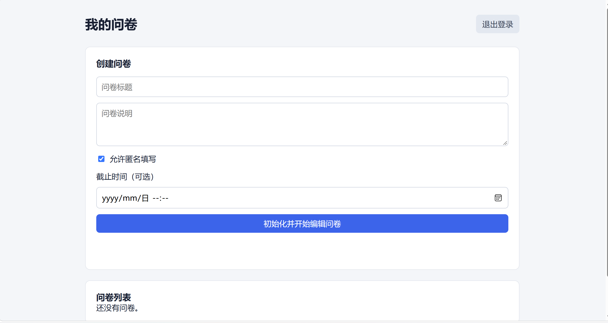

#### TC-02：创建问卷（含高级设置）
- **测试步骤**：
  1. 在控制台输入问卷标题和说明。
  2. 勾选“允许匿名填写”。
  3. 设置截止时间为未来的有效日期。
  4. 点击“初始化并开始编辑问卷”。
- **输入数据**：标题：`期末调查`，说明：`测试`，截止时间：`2026-12-31`
- **预期输出**：提示创建成功；问卷列表中出现该草稿，且显示截止时间。
- **实际结果**：通过。
- **截图证明**：
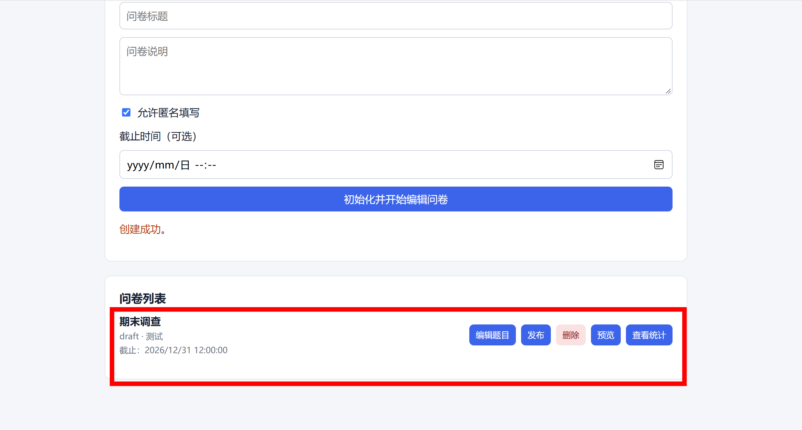

---

## 二、 添加题目测试

#### TC-03：添加多样化题型及限制配置
- **测试步骤**：
  1. 在问卷列表中点击编辑题目选项，进入问卷编辑页。
  2. 添加一道单选题。
  3. 添加一道多选题。
  4. 添加一道数字题，设置范围 0~100，勾选“必须为整数”。
- **输入数据**：单选、多选、数字（范围0-100的整数）
- **预期输出**：题目保存成功；列表显示已添加的题目。
- **实际结果**：通过。
- **截图证明**：
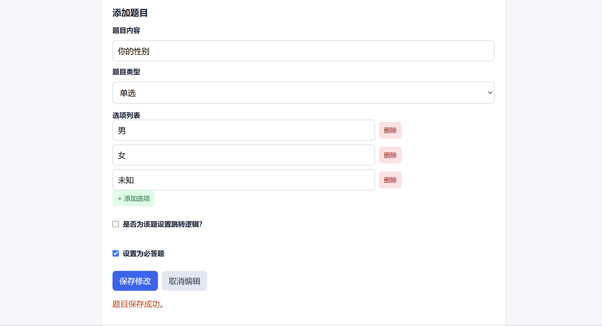
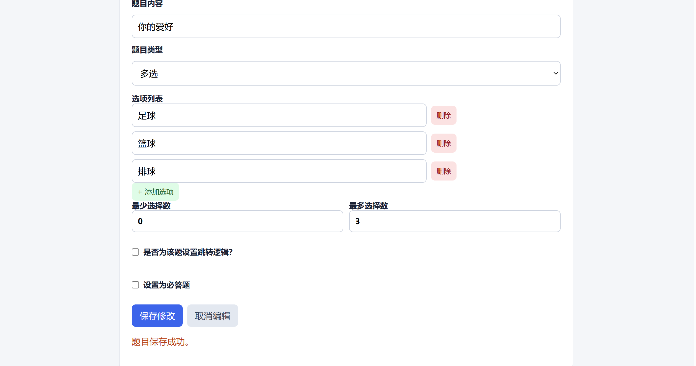
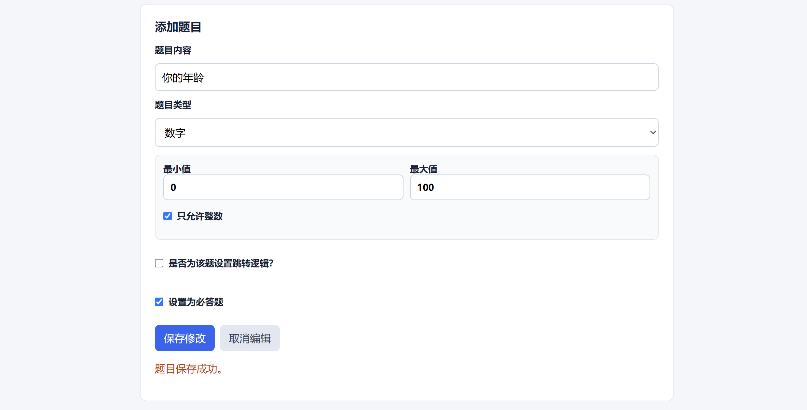
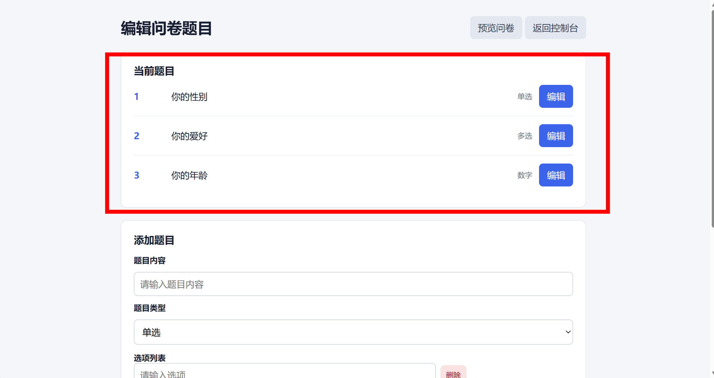

---

## 三、 跳转逻辑测试

#### TC-04：题目跳转规则的配置（防死循环）
- **测试步骤**：
  1. 回到第 1 题，勾选“是否为该题设置跳转逻辑”。
  2. 设置规则：选项 1 跳转到第 3 题。
  3. 观察跳转下拉框。
- **输入数据**：选第一项跳第 3 题
- **预期输出**：下拉框仅允许选择当前题目之后的题号；成功保存并生成 `routing_rules`。
- **实际结果**：通过。
- **截图证明**：
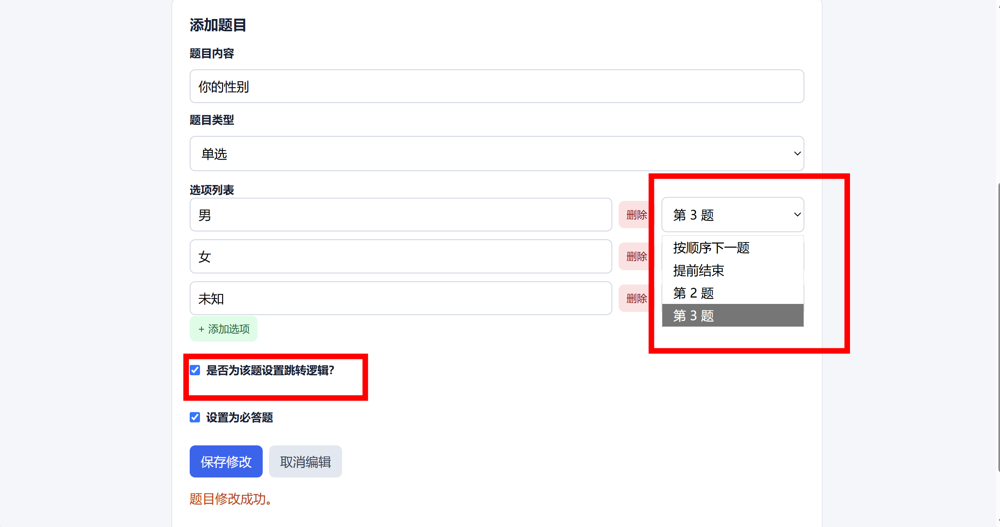

#### TC-05：前端动态跳转执行与视觉反馈
- **测试步骤**：
  1. 发布问卷，进入填写页。
  2. 在第 1 题选择选项 1。
- **输入数据**：第 1 题选 1
- **预期输出**：第 2 题自动隐藏；出现“已触发条件跳转”提示。
- **实际结果**：通过。
- **截图证明**：

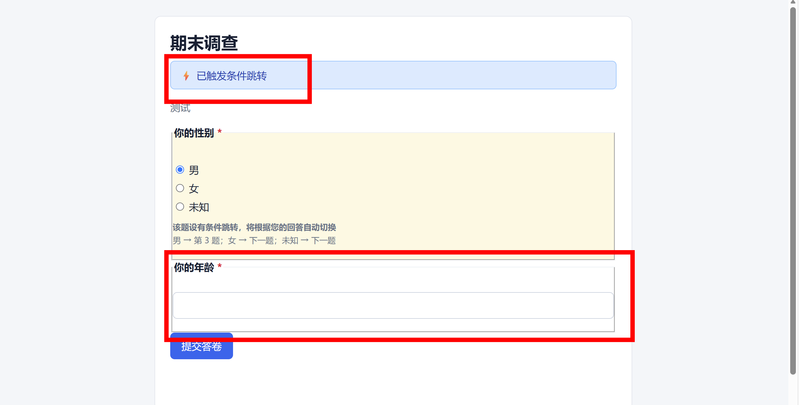

#### TC-06：数字题区间跳转（between）
- **测试步骤**：
  1. 编辑数字题，设置跳转规则为“介于 10 和 20 之间”跳转到结束。
  2. 填写页面输入 15。
- **输入数据**：数字输入 15
- **预期输出**：触发跳转规则，直接结束问卷（或跳到目标题）。
- **实际结果**：通过。
- **截图证明**：
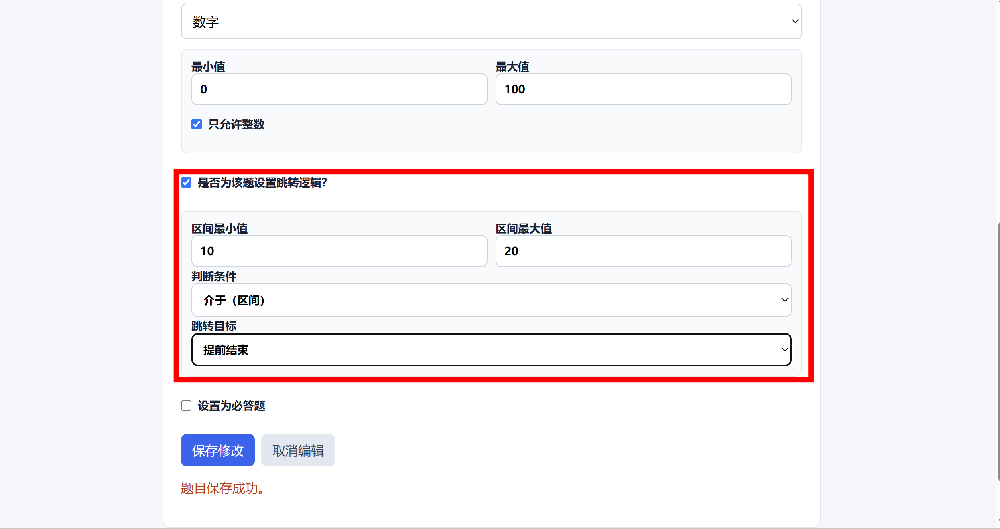
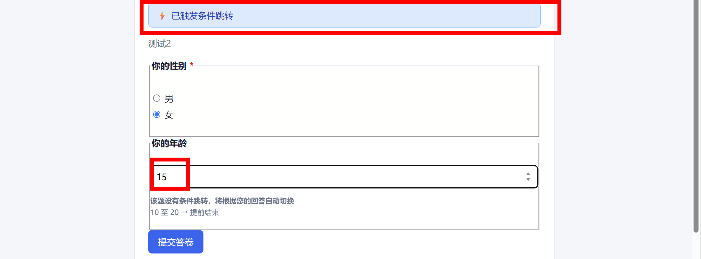

---

## 四、 校验测试

#### TC-07：前端必答与格式校验
- **测试步骤**：
  1. 将一道题设为必答。
  2. 在填写页不填该题，直接点击提交。
- **输入数据**：空内容
- **预期输出**：浏览器弹出提示框，阻止提交。
- **实际结果**：通过。
- **截图证明**：
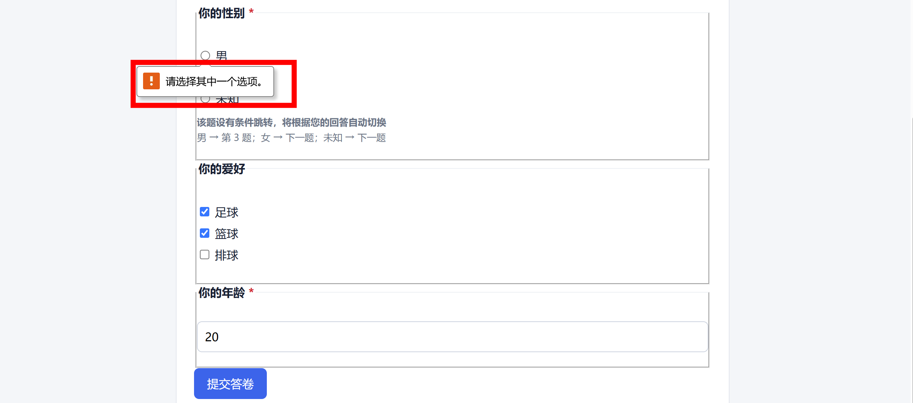

#### TC-08：后端越界数据校验拦截
- **测试步骤**：
  1. 数字题设置范围为 0~100。
  2. 填写时强行输入 150，并点击提交。
- **输入数据**：数字题填 150
- **预期输出**：提交失败，页面显示错误提示。
- **实际结果**：通过。
- **截图证明**：
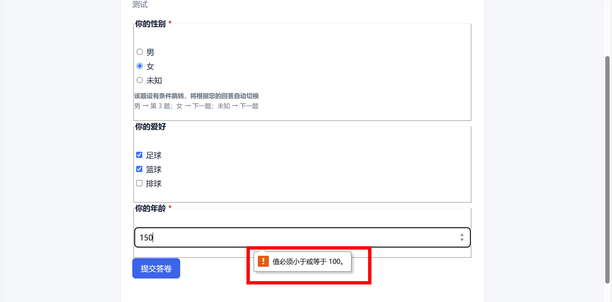

#### TC-09：配置端逻辑边界校验
- **测试步骤**：
  1. 进入编辑页。
  2. 文本框设置最小字数 50，最大字数 10。
  3. 点击保存。
- **输入数据**：最小>最大
- **预期输出**：弹窗报错“限制值设置错误（最小值不能大于最大值）”，阻止保存。
- **实际结果**：通过。
- **截图证明**：

---

## 五、 提交问卷测试

#### TC-10：正常提交答卷
- **测试步骤**：
  1. 按正常路径填写全部必答题。
  2. 点击“提交答卷”。
- **输入数据**：合法选项及数字
- **预期输出**：提示“答卷提交成功”。
- **实际结果**：通过。
- **截图证明**：
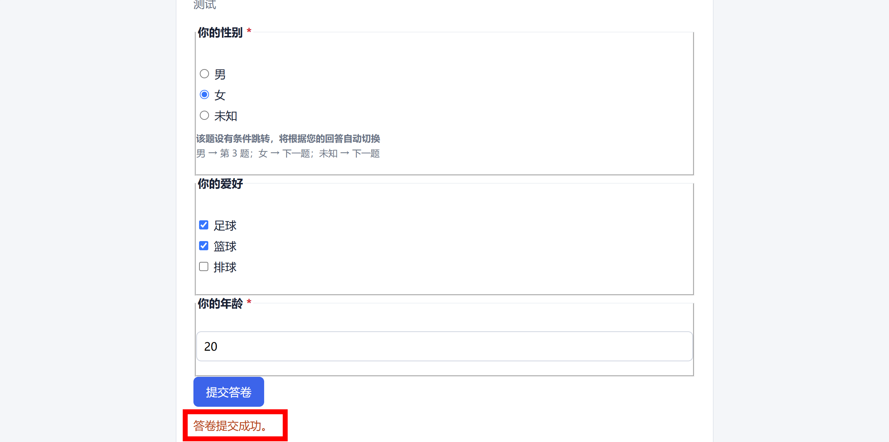

---

## 六、 统计测试

#### TC-11：单选/多选聚合统计
- **测试步骤**：
  1. 提交多次答卷。
  2. 返回控制台，点击“查看统计”。
- **输入数据**：3 份答卷
- **预期输出**：统计页面准确显示各个选项的被选次数。
- **实际结果**：通过。
- **截图证明**：

#### TC-12：文本与数字统计
- **测试步骤**：
  1. 数字题分别提交不同数值；文本题提交两段文字。
  2. 在统计页面查看。
- **输入数据**：21, 36
- **预期输出**：数字题显示“平均值：28.5”；文本题列出所有用户的填写内容。
- **实际结果**：通过。
- **截图证明**：
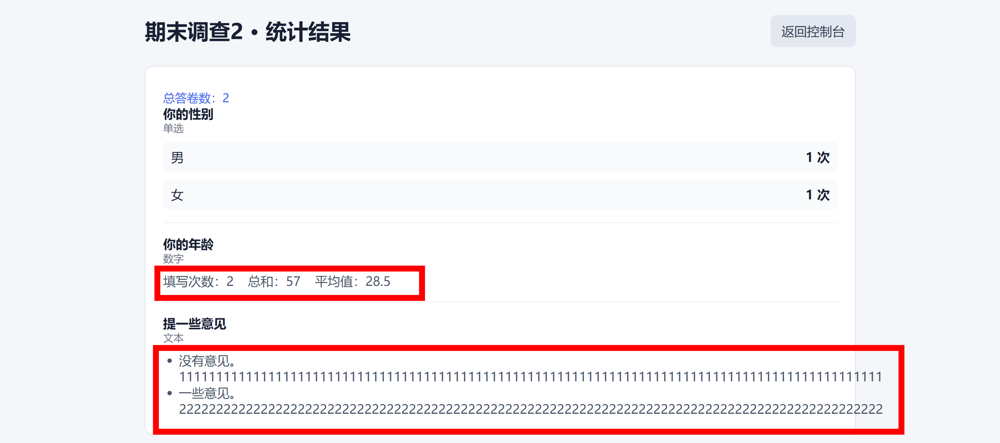