# 第二阶段：需求变更测试用例与结果

## 一、 题库管理与版本控制测试

#### TC-01：创建题库题目与历史版本回溯
- **测试步骤**：
  1. 进入“我的题库”页面，点击新建，输入一道单选题。
  2. 在列表中找到该题，点击“修改”，将题目文字和选项修改后保存为新版本。
  3. 点击“查看历史版本”。
  4. 将该题恢复为版本 v1。
- **输入数据**：原题：`你的性别`（男/女）；修改后：`你的性别是？`（男/女/保密）
- **预期输出**：题库成功生成 v1 和 v2 版本；历史弹窗中以只读表单形式展示该题目的所有版本；。
- **实际结果**：通过。
- **截图证明**：
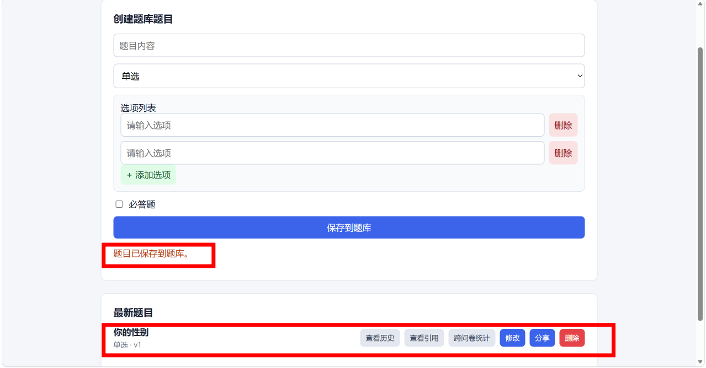

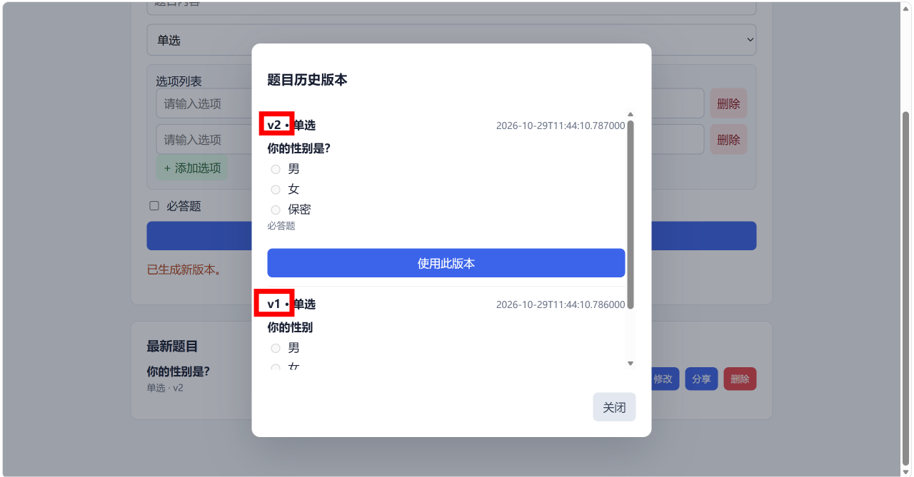
---
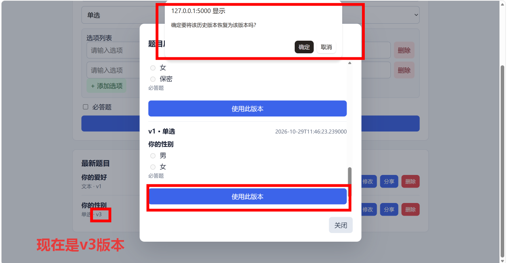
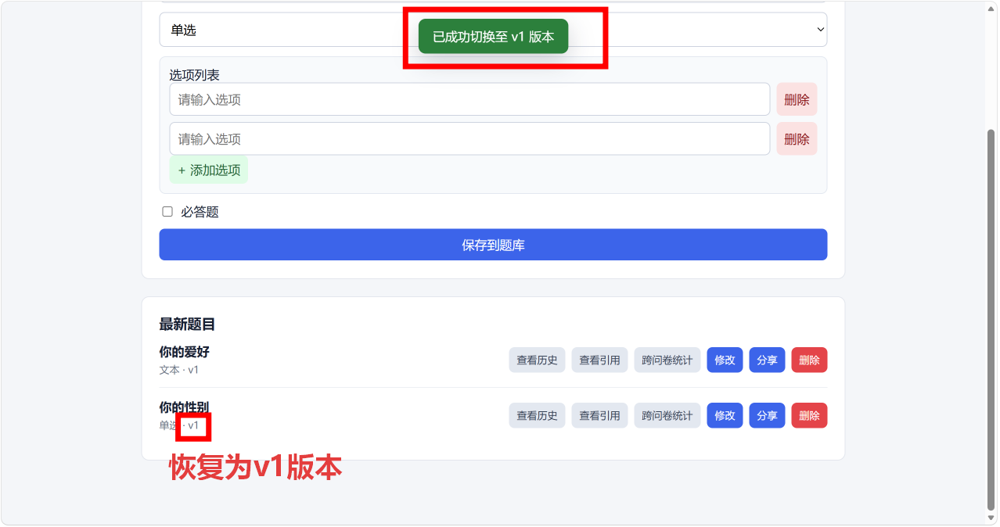

#### TC-02：跨用户题目分享机制
- **测试步骤**：
  1. 登录账号 A，在题库中点击某道题的“分享”按钮，输入账号 B 的用户名。
  2. 退出账号 A，登录账号 B，进入“我的题库”。
- **输入数据**：目标用户名：`李小红`
- **预期输出**：账号 B 的题库列表中出现了该题目；账号 B 能将该题导入自己的问卷。
- **实际结果**：通过。
- **截图证明**：

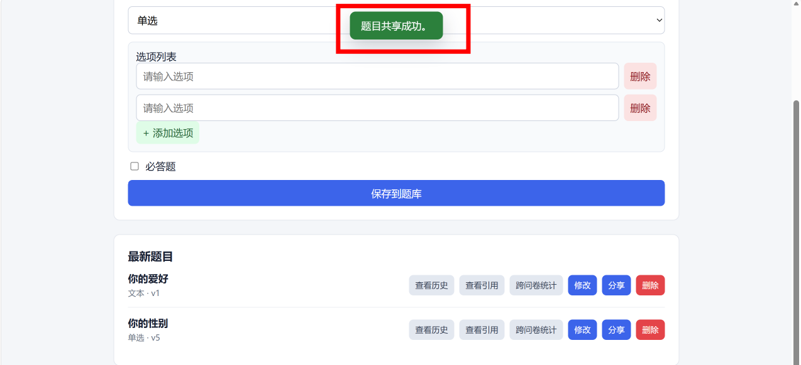

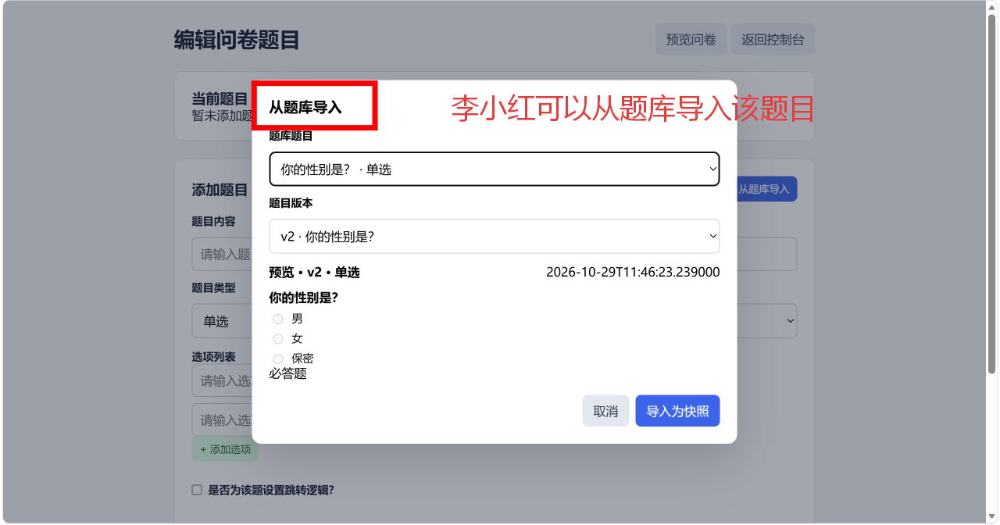

---

## 二、 问卷导入与快照隔离测试

#### TC-03：从题库导入特定版本至问卷
- **测试步骤**：
  1. 新建一个问卷，进入编辑页。
  2. 点击“从题库导入”，在弹窗中选择刚刚修改过的题目（TC-01 中的题）。
  3. 观察版本下拉框，选择 `v1` 版本，并在下方预览题目内容。
  4. 确认导入。
- **输入数据**：选择 v1 版本导入。
- **预期输出**：题目成功加入问卷，且预览区显示的是 v1 的旧内容，而非 v2 的最新内容。
- **实际结果**：通过。
- **截图证明**：
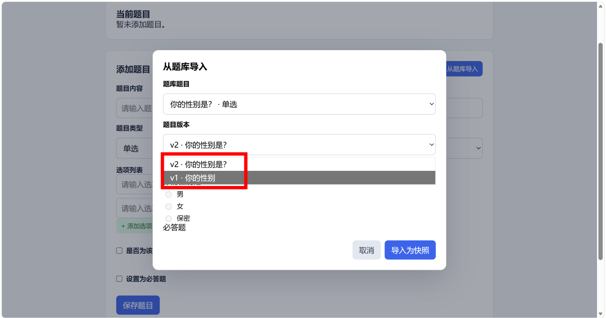
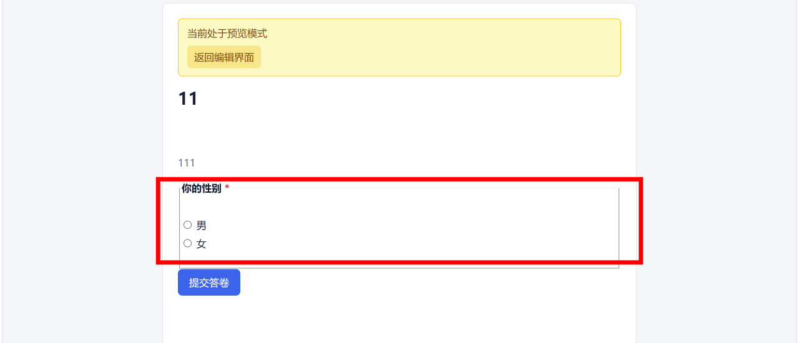

#### TC-04：修改快照题目的“双轨制”分叉
- **测试步骤**：
  1. 在问卷编辑页，点击刚刚导入的题目的“编辑”按钮。
  2. 观察界面出现的保存方式单选框。
  3. 选择 `仅修改当前问卷快照（不影响题库）`，修改内容后保存。
  4. 返回题库页面查看原题。
- **输入数据**：选择“仅改快照”，修改题目。
- **预期输出**：问卷内的题目更新了；但题库里的题目**未发生任何改变**。
- **实际结果**：通过。
- **截图证明**：
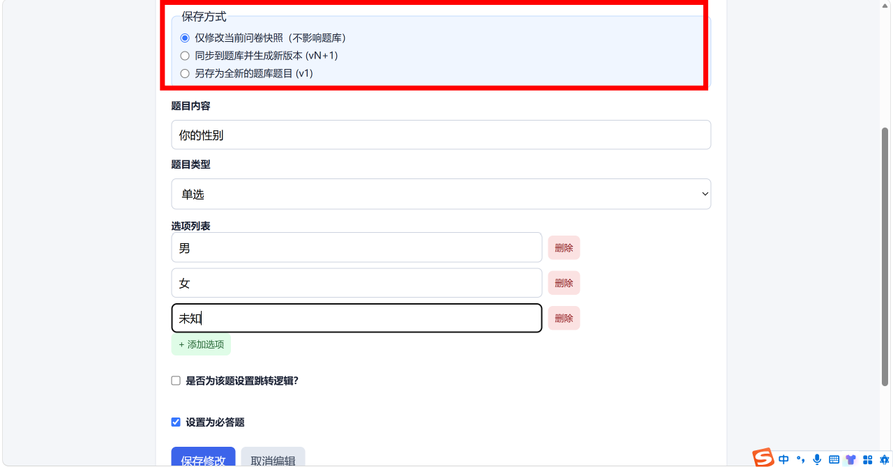

#### TC-05：问卷内原生题存入题库
- **测试步骤**：
  1. 在问卷编辑页，新建一道纯手敲的原生题（无题库来源）。
  2. 点击编辑，选择保存方式为 `将修改后的题保存到题库 (生成 v1)`。
  3. 保存后去题库查看。
- **输入数据**：手敲文本题。
- **预期输出**：问卷更新成功；题库中新增了一道对应的 v1 题目。
- **实际结果**：通过。
- **截图证明**：
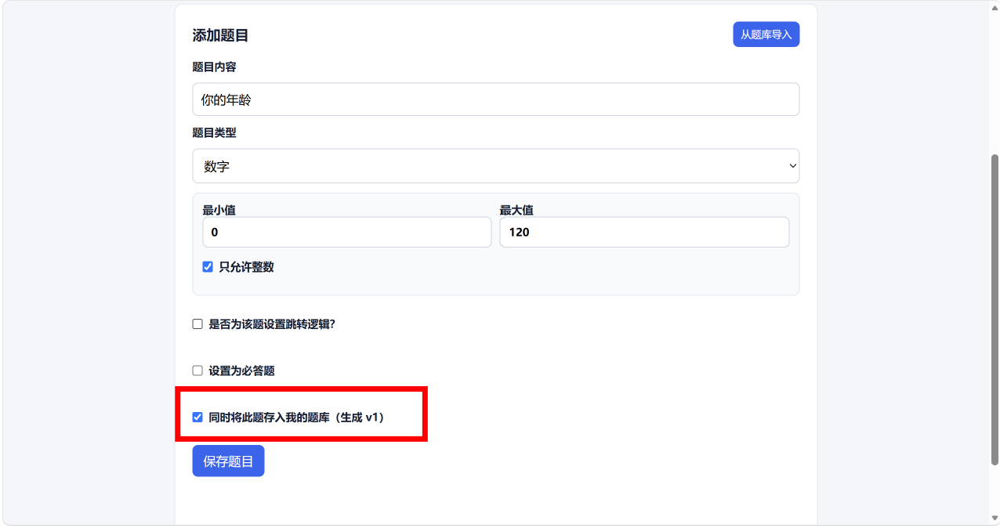
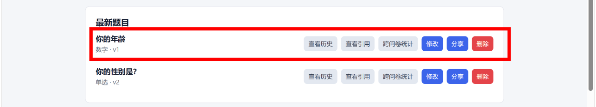

---

## 三、 引用溯源与跨问卷统计测试

#### TC-06：查看题目引用源及跳转
- **测试步骤**：
  1. 在题库页面，点击某道被多份问卷引用的题目上的“查看引用”按钮。
  2. 点击弹窗中列出的问卷标题。
- **输入数据**：无
- **预期输出**：弹窗列出使用该题的问卷及回答数；点击标题后新开标签页，跳转到该问卷的单题统计页面（`stats.html`）。
- **实际结果**：通过。
- **截图证明**：
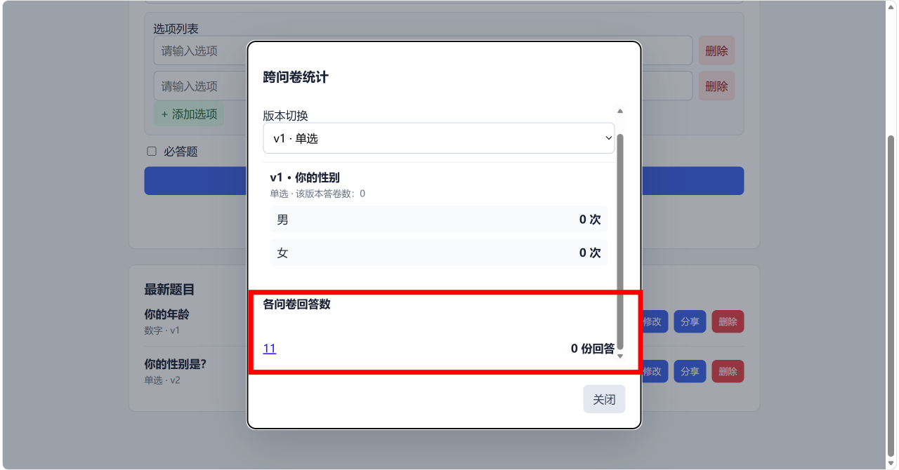
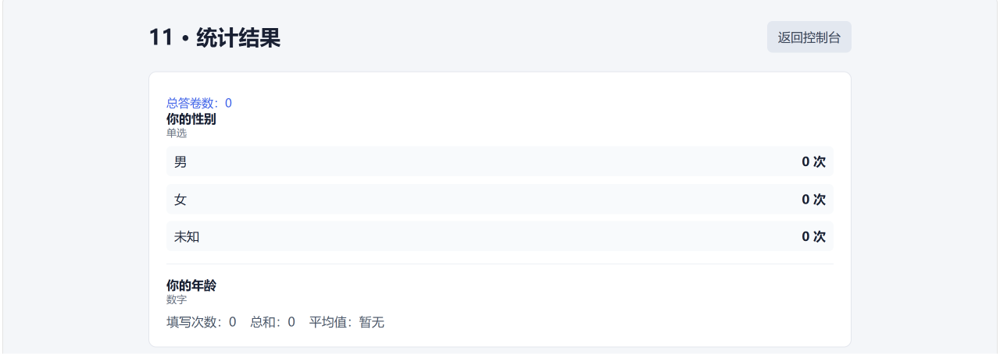

#### TC-07：跨问卷单题统计与版本切换（需求 8）
- **测试步骤**：
  1. 在题库页面，点击某道题的“跨问卷统计”按钮。
  2. 观察顶部全局摘要（引用总数、回答总数）。
  3. 在版本下拉框中，切换不同的版本（如 v1、v2），观察下方统计结果变化。
- **输入数据**：无
- **预期输出**：弹窗顶部显示全局统计摘要；下方能根据切换的版本，正确显示该版本在所有问卷中的合并统计，未收集数据的版本显示为 0 或空。
- **实际结果**：通过。
- **截图证明**：
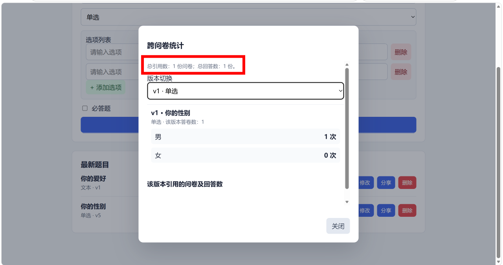
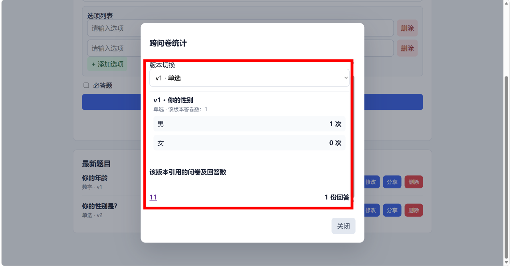
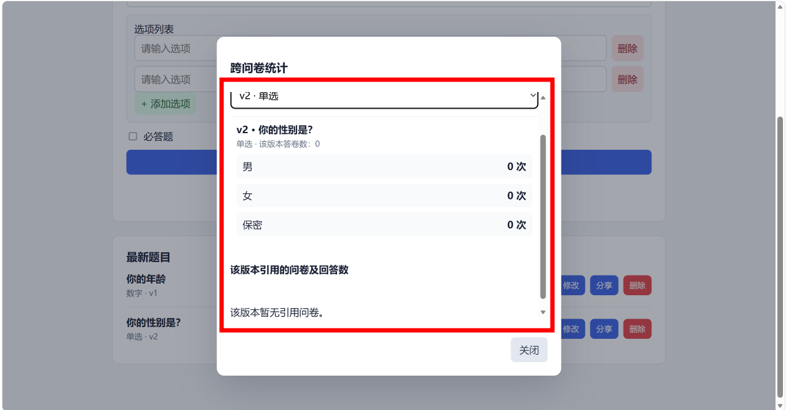

#### TC-08：题库删除保护
- **测试步骤**：
  1. 尝试删除一道**没有任何问卷引用**的题库题目。
  2. 尝试删除一道**已经被问卷导入引用**的题库题目。
- **输入数据**：点击红色的删除按钮。
- **预期输出**：无引用的题目被成功删除；页面弹出警告“该题已被问卷引用，无法删除”。
- **实际结果**：通过。
- **截图证明**：
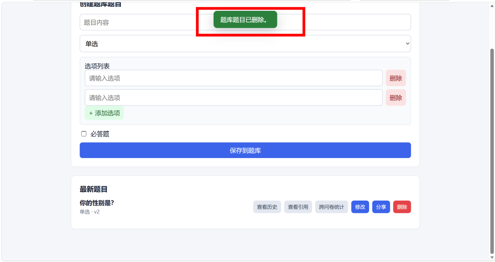
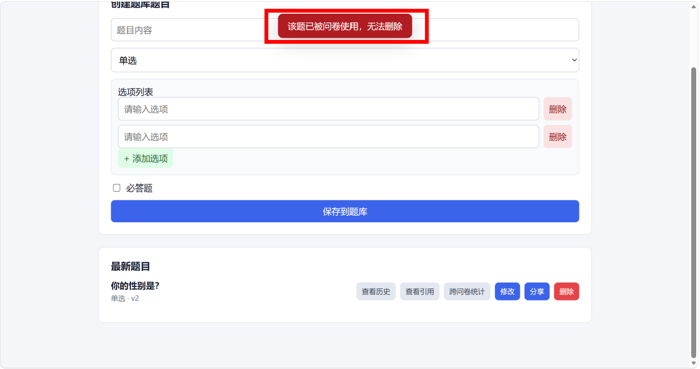

## 四、 问卷发布与快照隔离测试

#### TC-09：已发布问卷的题目防篡改与旧数据保护
- **测试步骤**：
  1. 创建一个新问卷，从题库导入一道题（假设当前题库该题为 v1 版本，内容为“你的爱好”）。
  2. 将问卷发布（状态变为 `published`）。
  3. 尝试回到该问卷的编辑页面，尝试修改这道题。
  4. 前往“我的题库”，将这道题修改为 v2 版本（内容改为“你的爱好是什么？”）。
  5. 重新打开刚刚那个**已发布**的旧问卷的填写链接或统计页，查看题目内容。
- **输入数据**：修改已发布问卷；在题库生成 v2 版本。
- **预期输出**：
  1. 已发布问卷无法进入编辑模式修改题目（系统拦截或前端隐藏按钮）。
  2. 题库升级到 v2 后，已发布的旧问卷中，题目内容**依然保持 v1 的“你的爱好”**。
- **实际结果**：通过。
- **截图证明**：

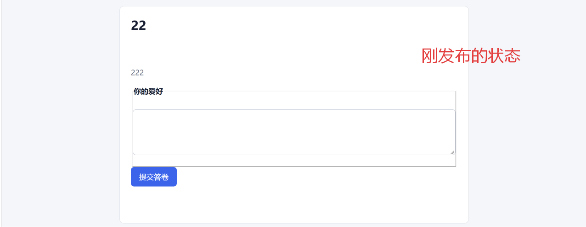
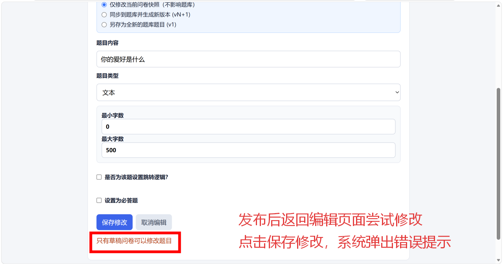
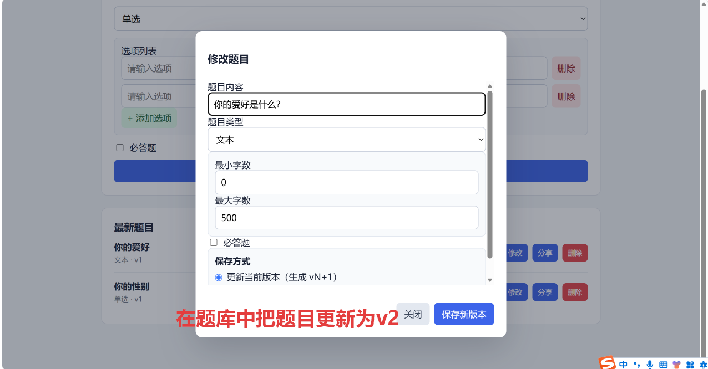
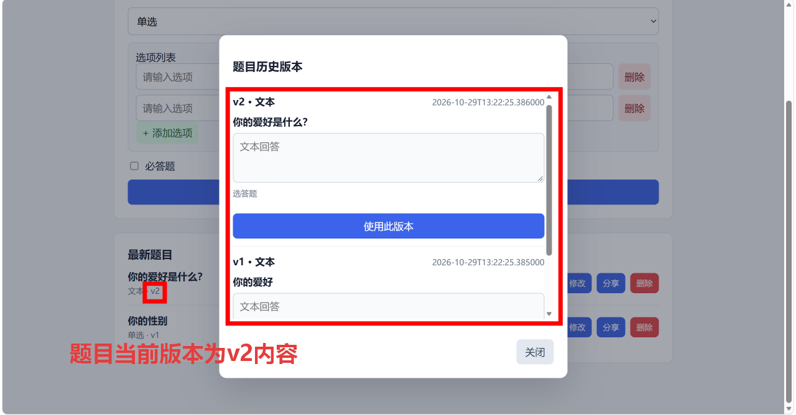
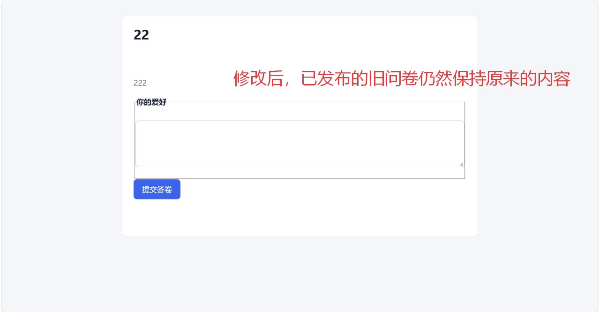